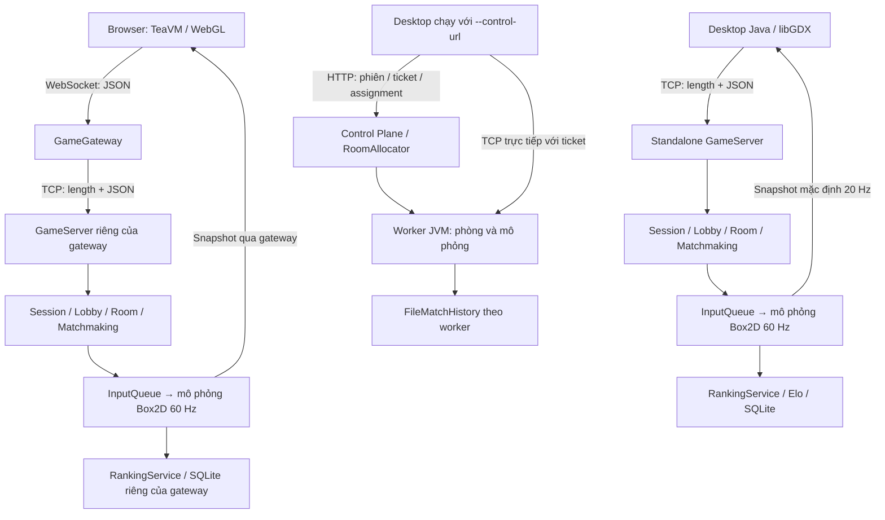

# Networked Super Smash Profs

Trò chơi đối kháng nhiều người chơi qua mạng, phát triển từ **Super Smash Profs** (Java/libGDX). Bản gốc hỗ trợ chơi local trên một bàn phím; bản của nhóm bổ sung server quyết định trạng thái trận đấu, TCP/JSON, phòng chơi, ghép trận, đồng bộ client, chiến đấu và Boss hợp tác, xếp hạng Elo/SQLite, client web và prototype phân phòng qua nhiều worker.

## Kiến trúc tổng quan



Standalone, web gateway và cluster là những cách chạy khác nhau. Gateway hiện khởi tạo GameServer riêng; nó không nối vào server desktop đang chạy. Cluster chưa tích hợp cơ sở dữ liệu Elo tập trung. Client gửi input; server kiểm tra, đưa vào hàng đợi và cập nhật thế giới vật lý. Client nhận snapshot để nội suy và trình bày. Chi tiết: [gameplay](docs/gameplay/README.md), [cluster](docs/scalability/README.md), [hiệu năng](docs/performance/README.md).

## Công nghệ và cấu trúc

| Thành phần | Công nghệ / vị trí |
|---|---|
| Ngôn ngữ, build | JDK 17, Gradle Wrapper 7.3.3 |
| Desktop và mô phỏng server | libGDX / Box2D 1.10.0, LWJGL3 cho desktop |
| Protocol | TCP, prefix độ dài 4 byte big-endian, JSON v1, Jackson 2.21.6; payload tối đa 1 MiB |
| Web | TeaVM 0.15.0, gdx-teavm 1.6.2, libGDX/Box2D-GWT 1.14.2; Java-WebSocket 1.6.0 cho gateway |
| Lưu trữ | SQLite JDBC 3.45.3.0; file JSON cho lịch sử cluster |
| Kiểm thử | JUnit 4; TCP loopback và fixture Box2D; Python cho kiểm tra deployment |
| Tài nguyên | Tiled TMX, sprite/âm thanh trong `final-project/assets/` |

```text
final-project/
  common/       DTO, protocol, framing, codec
  server/       TCP, room, mô phỏng, Boss, ranking, cluster
  core/         gameplay/UI/client networking dùng chung
  desktop/      launcher desktop
  tests/        kiểm thử client và tích hợp
  web/          client TeaVM và GameGateway (Gradle project riêng)
  teavm-probe/  bản thử và bridge WebSocket được gateway sử dụng
  assets/       tài nguyên chạy game
config/         cấu hình gameplay, scalability, performance
scripts/        runner, kiểm thử và đóng gói
docs/           thiết kế, bằng chứng kiểm thử và số liệu lịch sử
```

## Yêu cầu và cài đặt

- **JDK 17** (có cả `java` và `javac`), không dùng Java 8 mặc định của một số máy.
- Git và Internet trong lần build đầu để Gradle tải dependency; không cần cài Gradle riêng.
- Desktop cần môi trường đồ họa/OpenGL và native Box2D phù hợp hệ điều hành. Server chạy headless.
- Web cần Python 3.9+ để chạy preview và trình duyệt hỗ trợ WebGL/WebSocket. Build TeaVM dùng heap tối đa 768 MiB, ngoài heap của Gradle; cần chừa RAM cho cả hai.

```powershell
git clone https://github.com/Thai-DM/lap_trinh_mang.git
cd lap_trinh_mang
$env:JAVA_HOME = 'C:\duong-dan\toi\jdk-17'
$env:Path = "$env:JAVA_HOME\bin;$env:Path"
java -version
javac -version
cd final-project
.\gradlew.bat :server:installCluster :desktop:dist --no-daemon '-Dorg.gradle.jvmargs=-Xmx512m'
```

Thay đường dẫn JDK bằng đường dẫn thật. Linux/macOS dùng `export JAVA_HOME=/path/to/jdk17`, thêm `$JAVA_HOME/bin` vào `PATH` và thay `.\gradlew.bat` bằng `bash ./gradlew`. Lần đầu **không thêm `--offline`**. Trên macOS, khởi chạy client trực tiếp cần thêm `-XstartOnFirstThread` trước `-cp`.

## Chạy server và client desktop

Các lệnh dưới đây chạy từ **`final-project/`**. Mở hai terminal riêng sau khi build.

Terminal server (PowerShell):

```powershell
$env:SMASHPROFS_CLUSTER_SECRET = [guid]::NewGuid().ToString('N') + [guid]::NewGuid().ToString('N')
java -Xmx128m -cp 'build/cluster/*' com.smashprofs.server.cluster.ClusterMain standalone ../config/gameplay/local.properties
```

Chờ `STANDALONE_READY 54555`. Giữ terminal server mở; Ctrl+C để dừng. Secret dùng cho API quản trị, không phải mật khẩu người chơi. Không đưa giá trị thật vào Git.

Terminal client:

```powershell
java -Xmx192m -cp desktop/build/libs/desktop-1.0.jar com.smashprofs.game.DesktopLauncher --online
```

Mở lại lệnh client ở terminal khác để có người chơi thứ hai; lệnh chạy trực tiếp JAR không giữ Gradle bận. Trong Online, chọn cùng máy chủ `127.0.0.1:54555`; một người tạo phòng và gửi mã cho người còn lại, chọn nhân vật rồi Sẵn sàng. Có PvP 1v1, PvP bốn người và Boss hợp tác; ghép nhanh được tổ chức theo chế độ/sức chứa, chưa dựa trên Elo. Chọn Local ở menu chính để chơi phiên bản local.

Linux/macOS đặt secret bằng `export SMASHPROFS_CLUSTER_SECRET=$(python3 -c 'import secrets; print(secrets.token_hex(32))')`, sau đó dùng cùng lệnh `java`.

### Cấu hình và chơi qua LAN

[Cấu hình local](config/gameplay/local.properties) đặt TCP `54555`, admin `19200`, tối đa `64` kết nối; TCP mặc định chỉ nghe `127.0.0.1`. Để chơi LAN, sao chép file thành một cấu hình riêng, thêm `tcp.host=0.0.0.0`, đổi cổng nếu cần và truyền đường dẫn file đó cho `ClusterMain standalone`. Client chọn địa chỉ IP LAN của máy chủ và cùng cổng TCP. Mở firewall cho cổng TCP đã chọn; không nhập `0.0.0.0` làm địa chỉ server trên client. Không công khai cổng admin.

Luật trận (map, số mạng, thời gian, vật phẩm và chế độ) được chọn theo phòng. Muốn dùng CLI thay giao diện chọn máy chủ:

```powershell
java -Dsmashprofs.server.host=192.168.1.10 -Dsmashprofs.server.port=54555 -cp desktop/build/libs/desktop-1.0.jar com.smashprofs.game.DesktopLauncher --online
```

### Database và dữ liệu

Không phải cài dịch vụ database hay nhập SQL thủ công. `SqliteRankingStore` tạo bảng khi khởi tạo. Standalone mặc định tạo `ranking.db` tương đối với thư mục chạy; có thể đặt `ranking.db=data/ranking.db` trong file cấu hình. Nếu SQLite không mở được, standalone ghi cảnh báo và chuyển sang store trong RAM: điểm khi đó không bền vững sau khởi động lại. Cần kiểm tra log khi demo ranking.

`GameGateway` dùng SQLite riêng, mặc định `web/build/run/ranking.db` khi chạy từ `web/`; có thể truyền đường dẫn database ở đối số thứ hai. Sao lưu database khi server đã dừng. Không đưa database người chơi, token hồ sơ khách hoặc secret thật lên Git. Cluster dùng `FileMatchHistory`, chưa có ranking SQLite dùng chung giữa các worker.

## Chạy client web

Từ **gốc repository**, PowerShell:

```powershell
.\scripts\web\Run-Web.ps1 -JavaHome $env:JAVA_HOME
```

Script build server và TeaVM, chạy gateway `8090`, phục vụ trang web `8088`, rồi in URL có tham số `?ws=...`. Dùng URL đó ở hai cửa sổ trình duyệt để tạo/vào cùng phòng; Ctrl+C dừng các tiến trình của script. Sau khi build thành công có thể thêm `-SkipBuild`. Đổi cổng bằng `-Port` và `-GatewayPort`. Đây là preview loopback; HTTPS triển khai thật cần WSS và cấu hình origin. [Hướng dẫn web](final-project/web/README.md), [triển khai](docs/gameplay/19-AZURE-AUTO-DEPLOY.md).

Build và chạy thủ công trên Linux/macOS hoặc khi không dùng runner (từ `final-project/`):

```sh
bash ./gradlew :server:installCluster --no-daemon -Dorg.gradle.jvmargs=-Xmx512m
bash ./gradlew -p web test buildWeb prepareGateway --no-daemon -Dorg.gradle.jvmargs=-Xmx512m
cd web
java -Xmx192m -cp 'build/gateway/lib/*' com.smashprofs.web.GameGateway 8090
```

Terminal khác, từ `final-project/web/`: `python3 -m http.server 8088 --bind 127.0.0.1 --directory build/dist/webapp`. Mở `http://127.0.0.1:8088/?ws=ws%3A%2F%2F127.0.0.1%3A8090`. Gateway tự chạy GameServer; không cần mở thêm standalone để chơi web. Desktop và web ở các server độc lập không tự thấy phòng của nhau.

## Prototype phân tán

Chuẩn bị dependency bằng `:server:installCluster` trước. Từ gốc repository:

```powershell
.\scripts\scalability\Start-Cluster.ps1 -JavaHome $env:JAVA_HOME
Invoke-RestMethod http://127.0.0.1:8080/metrics
# Dừng đúng các tiến trình cluster do runner quản lý:
.\scripts\scalability\Stop-Cluster.ps1
```

Mặc định có ba worker JVM, TCP `9001–9003`, admin `9101–9103`, control plane `8080`; cần RAM cho ba worker và supervisor. Từ `final-project/`, desktop có thể chạy với `--control-url=http://127.0.0.1:8080 --create-room`, hoặc `--control-url=http://127.0.0.1:8080 --join-room --room=r_ID` (thay ID thật). Control plane cấp assignment/ticket; client sau đó kết nối TCP trực tiếp worker. Xem [cấu hình](config/scalability/local.properties) và [hướng dẫn cluster](docs/scalability/README.md). Chế độ này hiện là prototype local, chưa có migration trận đang chạy hoặc persistence Elo tập trung.

## Kiểm thử và CI

Từ `final-project/`, chạy nhóm kiểm tra mạng/gameplay tiêu biểu:

```powershell
.\gradlew.bat :common:test :server:test --tests '*TcpProtocolV1Test' --tests '*TwoClientTcpMatchEndToEndTest' --tests '*FourClientTcpMatchEndToEndTest' --tests '*BossModeTest' --tests '*RankingServiceTest' --tests '*RatingEngineTest' --tests '*RankingEndToEndTcpTest' :tests:test --tests '*PacketFramingTest' --tests '*StateInterpolatorTest' --tests '*GameStartRosterTest' --no-daemon '-Dorg.gradle.jvmargs=-Xmx512m'
```

Để chạy toàn bộ unit/integration test: `.\gradlew.bat :common:test :server:test :tests:test --no-daemon '-Dorg.gradle.jvmargs=-Xmx512m'`. Một số test khởi tạo socket loopback và process con; cần cho phép Java lắng nghe local và đủ RAM. Kết quả HTML ở `common/build/reports/tests/test/`, `server/build/reports/tests/test/`, `tests/build/reports/tests/test/`. Kiểm tra web riêng bằng `.\gradlew.bat -p web test`.

Từ gốc repository: `python -m unittest discover -s scripts/web/tests -v`. Linux/Git Bash: `bash scripts/web/tests/test-deploy.sh` kiểm tra switch/rollback bằng môi trường giả lập, không triển khai lên VM. Workflow [web-build.yml](.github/workflows/web-build.yml) build/test khi push `main`, `dev` và nhánh web. Deploy Azure hiện chỉ gắn với nhánh web và cần Actions secrets; push `main` chạy job build, không đổi môi trường deploy.

## Kết quả thực nghiệm và đóng góp

Các số liệu dưới đây là **phép đo lịch sử ngày 15/10/2026**, JDK 17.0.12, Windows/i5-1135G7, TCP loopback, bot và server cùng máy; không phải benchmark cho mọi phiên bản sau đó.

| Kịch bản | Kết quả quan sát |
|---|---|
| Baseline IDLE, 4 client / 1 worker / 1 phòng, cửa sổ khoảng 45 giây sau warmup | 60,004 cycle/s; worker-cycle p99 1,671 ms; room-tick p99 1,327 ms |
| Cùng cửa sổ đo | Khoảng 20,105 snapshot/client/s; scheduling-lag p99 16,384 ms |
| So sánh tối ưu A/B | Chưa đủ cặp đo do giới hạn RAM; chưa chứng minh cải thiện định lượng |

Nguồn số liệu: [summary JSON](docs/performance/runs/20261015-221532/shared-ab/IDLE-4-baseline-1/summary.json), [phương pháp và giới hạn](docs/performance/08-BENCHMARKS.md). Kết quả kiểm tra chuẩn bị `main` được ghi riêng tại [README-REVIEW.md](docs/submission/README-REVIEW.md); số test chức năng không thay thế số đo hiệu năng.

So với game local, đóng góp kỹ thuật gồm: đưa mô phỏng lên server và xử lý input qua hàng đợi; tách TCP stream thành frame có giới hạn; quản lý nhiều phiên/phòng và backpressure snapshot; nội suy trạng thái ở client; Boss do server điều khiển; lưu kết quả/xếp hạng có kiểm soát trùng trận; phân phòng qua control plane/worker; tái sử dụng client Java trên browser qua TeaVM và bridge WebSocket. Đây là cải tiến của dự án so với baseline, không phải tuyên bố thuật toán mới của ngành. Chi tiết có trong các tài liệu source/test được liên kết phía trên.

## Giới hạn

- TCP có thể gây head-of-line blocking; nội suy không loại bỏ độ trễ mạng. Chưa có bộ đo WAN đại diện.
- Không có bằng chứng cho tải 100 triệu CCU; các tài liệu capacity trình bày mô hình ước lượng.
- Load-aware allocation và adaptive snapshot đã có code, nhưng chưa có benchmark A/B đầy đủ để định lượng lợi ích.
- Cluster chưa bảo toàn trận khi worker chết và chưa hợp nhất SQLite/Elo giữa các worker; ghép trận chưa dựa trên trình độ.
- Hồ sơ khách không thay thế hệ thống tài khoản/xác thực hoàn chỉnh. TCP trực tiếp không có TLS; deployment web cần reverse proxy HTTPS/WSS.
- Công thức Elo nhiều người và giấy phép toàn bộ tài nguyên kế thừa còn cần nhóm rà soát trước khi phát hành rộng rãi.

## Nguồn gốc, tham khảo và nộp bài

Giữ thông tin tác giả và README của game gốc tại [README_UPSTREAM.md](final-project/README_UPSTREAM.md). Code/gameplay local và tài nguyên kế thừa không được nhận là toàn bộ do nhóm viết. Giấy phép Apache 2.0 được README gốc nêu, nhưng repository hiện chưa có đầy đủ bằng chứng giấy phép cho mọi thành phần; cần xác minh trước khi tái phân phối. Ghi công Boss/hiệu ứng: [assets/boss/README.md](final-project/assets/boss/README.md).

Tài liệu công nghệ: [libGDX](https://libgdx.com/), [Java Socket](https://docs.oracle.com/en/java/javase/17/docs/api/java.base/java/net/Socket.html), [TeaVM](https://teavm.org/), [SQLite JDBC](https://github.com/xerial/sqlite-jdbc), [Tiled](https://www.mapeditor.org/).

Yêu cầu học phần: [Instruction](final-project/Instruction.md), [Topics](final-project/Topics.md), [Submission](final-project/Submission.md). Theo `Submission.md`, bàn giao `NhomXX_NetworkedSuperSmashProfs/Source/` và `Report/`; báo cáo có tên `NhomXX_NetworkedSuperSmashProfs_Report.docx`, hạn 23:59 ngày **31/10/2026**. `XX` giữ lại cho đến khi nhóm xác nhận số nhóm. GitHub hỗ trợ quản lý source; không thay thế việc nộp báo cáo trên Compilatio và bàn giao theo hướng dẫn giảng viên. Bản báo cáo đang biên tập, tài liệu mẫu của nhóm khác, dữ liệu chạy và thông tin cá nhân chưa chốt không nằm trong bản source phát hành này.
