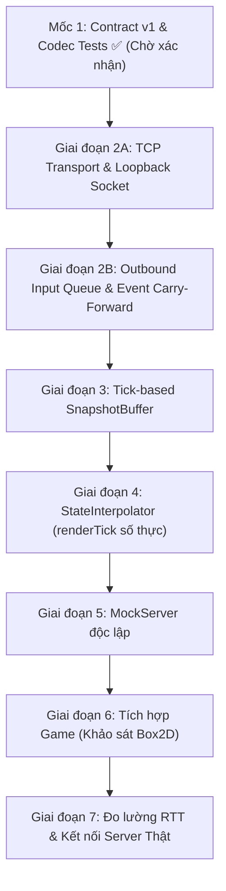

# 🗺️ Lộ trình nhiệm vụ Người 2: Client Networking (Bản Kiến Trúc Chuẩn Hóa)

> **Mục tiêu cuối:** Client Java kết nối server (hoặc MockServer), gửi input từ hàng đợi bất đồng bộ, nhận `GameSnapshot`, điều phối buffer nội suy mượt mà ở 60 FPS mà không xung đột với Box2D physics của game gốc.

---

## 1. Bảng theo dõi tiến độ tổng thể

| Giai đoạn | Nội dung công việc | Trạng thái | Deliverable đạt được |
|---|---|:---:|---|
| **Mốc 1: Contract v1 & Codec** | DTOs, Framing, Round-trip, Golden Fixtures, Deterministic Framing | **HOÀN THÀNH** ✅ *(Đã push dev)* | 18/18 unit tests xanh; wire format tự nhất quán 100%. |
| **Giai đoạn 2A: TCP Transport** | Kết nối TCP, Reader/Writer threads, xử lý EOF/timeout, Loopback Socket Test (Port 0) | **HOÀN THÀNH** ✅ *(Đã push dev)* | 6/6 loopback tests xanh; Reader-only callbacks, non-blocking send, đóng tài nguyên sạch. |
| **Giai đoạn 2B: Outbound Input Queue** | Bounded queue, non-blocking render thread, merge Continuous State, carry-forward Discrete Events | **HOÀN THÀNH** ✅ *(Sẵn sàng push)* | 5/5 unit tests xanh: bảo toàn phím nhảy/đánh khi gộp, sequence tăng đều, test đa luồng. |
| **Giai đoạn 3: SnapshotBuffer** | Tick-based Bounded Queue, Thread Safety, Immutability, Drop/Hold policy | 🟡 **TIẾP THEO** | Concurrency test producer/consumer không race condition. |
| **Giai đoạn 4: StateInterpolator** | Số thực `renderTick` tăng đều theo delta, Pre-buffering, Hold/Freeze khi lag | ⚪ Chưa bắt đầu | Unit test Lerp độc lập tách biệt khỏi LibGDX/OpenGL. |
| **Giai đoạn 5: MockServer** | Giả lập server gửi snapshot 30Hz, vòng đời `start()`/`stop()`, cờ `--mock` | ⚪ Chưa bắt đầu | Chạy game độc lập với MockServer mà không cần server thật. |
| **Giai đoạn 6: Tích hợp Game (Vùng Vàng)** | Khảo sát Box2D; Hook `PlayScreen`, `LocalPlayer` đọc phím, `RemotePlayer` hiển thị nội suy | ⚪ Chưa bắt đầu | 2 nhân vật di chuyển mượt trên màn hình; đóng game sạch. |
| **Giai đoạn 7: Đo lường & Server Thật** | RTT/Ping, Snapshot rate, xử lý ngắt kết nối, hiển thị `MatchResult`/`Ranking` | ⚪ Chưa bắt đầu | Báo cáo số liệu thực tế; bàn giao tích hợp server nhóm. |

---

## 2. Nguyên tắc kiến trúc cốt lõi (Sau phản biện hoàn thiện)

| Vấn đề | Thiết kế cũ (sai sót) | Thiết kế chuẩn hóa (áp dụng) |
|---|---|---|
| **Tiến trình thời gian nội suy** | `renderTick = latestServerTick - delayTicks` tính lại mỗi frame (bị giật 30Hz) | **Biến số thực `renderTick`** tích lũy liên tục: `renderTick += deltaSeconds * serverTickRate`. Pre-buffer đủ mốc rồi mới chạy; Hold/Freeze khi underflow; **chưa thêm Drift Correction tự động** vào MVP để tránh giật vận tốc ảo do jitter. |
| **Hàng đợi input & Quá tải** | Drop Oldest tùy tiện (nguy cơ mất phím nhảy/đánh) | **Non-blocking trên Render Thread (`offer`)**: Gộp Continuous State (`moveAxis`, `blockHeld`), nhưng **chuyển tiếp sự kiện chưa gửi (Carry-forward Discrete Events)** sang frame giữ lại. Nếu nghẽn kéo dài không thể chứa thêm: kích hoạt chính sách báo lỗi/nghẽn mạng, không âm thầm nuốt phím. |
| **Xung đột Box2D** | Ép chuyển sang Kinematic / gán snapshot đè lên body | **Investigation Item ở GĐ 6**: Khảo sát sensor và contact của `Player.java` để tách trạng thái hiển thị khỏi body vật lý hoặc đồng bộ an toàn sau `world.step()`. |
| **Quyền sở hữu Contract** | Người 2 tự quyết định DTO | Người 2 hoàn thành kiểm chứng draft v1 cho `common/` → **Chờ Người 3 (chủ sở hữu protocol) xác nhận đóng băng**. Sau khi đóng băng, Người 2 tuân thủ 100%. |
| **Cấu trúc source** | Giả định `src/main/java` | Tuân thủ convention thực tế: `:core` dùng `core/src/com/...`, `:common` dùng `common/src/main/java/...`. |

---

## 3. Chi tiết từng giai đoạn thực hiện



---

### Mốc 1 — Khóa Contract v1, Framing & Codec Tests
* **Trạng thái:** **HOÀN TẤT KỸ THUẬT CLIENT-SIDE** *(Chờ Người 3 xác nhận đóng băng)*.
* **Kết quả:** `BUILD SUCCESSFUL`, **21/21 tests passed** trên task `:common:test --rerun-tasks`.
* **Deliverables đã hoàn thành:**
  * `DtoRoundTripTest.java` (7 tests): Round-trip serialize/deserialize 2 chiều cho mọi DTO.
  * `GoldenFixtureContractTest.java` (6 tests): Khẳng định chính xác từng tên key JSON, parse từ golden fixture của protocol v1, test tương thích trường rỗng/null.
  * `PacketFramingTest.java` (8 tests): Khẳng định xử lý phân mảnh xác định với `ChunkedInputStream`, nhiều frame nối tiếp, phân biệt đóng sạch EOF vs EOF dở dang, từ chối độ dài âm/quá tải.

---

### Giai đoạn 2A — TCP Transport & Loopback Test (HOÀN THÀNH ✅)
* **Mục tiêu:** Thiết lập kết nối TCP tin cậy, luồng đọc/ghi riêng biệt, kiểm thử qua Loopback Socket trên port động.

```
core/src/com/smashprofs/game/network/client/
    NetworkClient.java          # Luồng Reader + Luồng Writer riêng biệt, quản lý Socket
    ConnectionListener.java     # Callback sự kiện: onConnected, onPacketReceived, onDisconnected
```

| Việc cần làm | Chi tiết kỹ thuật |
|---|---|
| Quản lý kết nối & Socket | Kết nối tới host/port; thiết lập luồng Reader và Writer độc lập; có timeout kết nối hữu hạn. |
| Reader Thread | Đọc liên tục bằng `PacketFraming.readPacketOrNull(in)`: khi nhận frame hoàn chỉnh $\rightarrow$ gọi `listener.onPacketReceived(packet)`. Phân biệt đóng sạch EOF và lỗi đường truyền để kích hoạt `onDisconnected`. |
| Writer Thread | Lấy packet từ blocking queue nội bộ của transport và ghi ra socket bằng `PacketFraming.writePacket(out, packet)`. Tuyệt đối không ghi socket trực tiếp trong render loop. |
| Đóng tài nguyên sạch | Hàm `disconnect()`: đóng socket, interrupt các luồng, giải phóng tài nguyên mà không để lại thread treo. |
| Loopback Socket Test | Tạo `ServerSocket(0)` trên loopback `127.0.0.1`, lấy port thực cấp bởi OS (`getLocalPort()`). Client kết nối, gửi và nhận các packet mẫu (`PING`, `JOIN_ROOM`), xác nhận truyền tin thông suốt. |

* **Deliverable:** 6/6 Loopback Integration tests xanh — gửi/nhận `NetworkPacket` ổn định qua TCP thật (port 0), xử lý ngắt kết nối sạch, non-blocking send, và Reader-only callback dispatch.

---

### Giai đoạn 2B — Outbound Input Queue & Event Carry-Forward (TIẾP THEO 🟡)
* **Mục tiêu:** Thu thập input từ game loop một cách bất đồng bộ, không bao giờ chặn Render Thread, bảo toàn sự kiện khi nén dữ liệu.

```
core/src/com/smashprofs/game/network/client/
    OutboundInputQueue.java     # Hàng đợi bounded, gom continuous state, bảo lưu discrete events
    InputNetworkAdapter.java    # Cầu nối: đọc input người chơi, đưa vào OutboundInputQueue
```

| Việc cần làm | Chi tiết kỹ thuật |
|---|---|
| Non-blocking Render Thread | Mọi thao tác thêm input từ render loop phải dùng `offer()`, tuyệt đối không dùng `put()` gây block game loop. |
| Gom Continuous State | Nếu có nhiều input frame chưa kịp gửi: các trạng thái liên tục (`moveAxis`, `blockHeld`) được cập nhật theo giá trị mới nhất. |
| Bảo toàn Discrete Events (Carry-Forward) | Nếu gộp frame hoặc thay thế frame cũ: các sự kiện nhấn (`jumpPressed`, `meleePressed`, `stompPressed`, `abilityPressed`) còn đang chờ gửi **phải được chuyển tiếp sang frame được giữ lại**, đảm bảo không nuốt nút người chơi. |
| Chính sách quá tải hữu hạn | Nếu hàng đợi đầy liên tục do nghẽn mạng nghiêm trọng: kích hoạt chính sách báo lỗi quá tải (log warning, đánh dấu phiên suy giảm), tuyệt đối không để tràn bộ nhớ hoặc treo máy. |

* **Deliverable:** Unit test hàng đợi: kiểm tra `offer()` không block, test gộp `moveAxis` thành công, test bảo toàn cờ `jumpPressed` khi gộp frame, test kích hoạt chính sách quá tải khi queue đầy.

---

### Giai đoạn 3 — SnapshotBuffer (Tick-based) & Thread Safety
* **Mục tiêu:** Quản lý luồng snapshot đến, bảo đảm an toàn dữ liệu giữa Network Thread (ghi) và Render Thread (đọc).

```
core/src/com/smashprofs/game/network/client/
    SnapshotBuffer.java         # Lưu trữ bounded snapshot theo serverTick
```

| Việc cần làm | Chi tiết kỹ thuật |
|---|---|
| Thứ tự & Lọc gói tin | Snapshot phải có `serverTick` tăng đơn điệu. Bỏ qua snapshot đến muộn (tick cũ hơn snapshot đã có). |
| Chính sách dung lượng | Bounded queue (ví dụ: giữ 10–20 snapshot gần nhất). Bỏ bớt snapshot cũ khi vượt ngưỡng. |
| Bảo đảm bất biến (Immutability) | Dữ liệu `PlayerState` bên trong snapshot phải là bất biến hoặc được deep-copy trước khi render thread đọc (`List.copyOf` là shallow copy, không đủ tự bảo vệ object bên trong). |
| Concurrency Test | Producer thread (đẩy snapshot 30Hz) và Consumer thread (lấy snapshot 60Hz) chạy song song với `CountDownLatch`. Kiểm tra không có race condition hay lỗi rách dữ liệu. |

* **Deliverable:** Concurrency test xanh dưới áp lực chạy 10–30 giây.

---

### Giai đoạn 4 — StateInterpolator (Nội Suy Trạng Thái)
* **Mục tiêu:** Chuyển động 60 FPS mượt mà từ snapshot 30 Hz của server, giải quyết hiện tượng jitter mạng.

```
core/src/com/smashprofs/game/network/client/
    StateInterpolator.java        # Hàm thuần tính Lerp vị trí
    InterpolationCoordinator.java   # Điều phối renderTick số thực và chọn cặp snapshot mốc
```

| Việc cần làm | Chi tiết kỹ thuật |
|---|---|
| Quy tắc Render Time số thực | `renderTick` là biến số thực, tích lũy liên tục mỗi frame: `renderTick += deltaSeconds * serverTickRate`. |
| Khởi tạo & Pre-buffering | Chờ tích lũy đủ dữ liệu ban đầu (ví dụ: tối thiểu 3 snapshots) trước khi bắt đầu nội suy. Khởi tạo: `renderTick = latestServerTick - delayTicks` (với `delayTicks = 2`). |
| Cặp snapshot mốc & Lerp | Tìm Snapshot A ($t_0 \le \text{renderTick}$) và Snapshot B ($t_1 > \text{renderTick}$). Tính $\alpha = \frac{\text{renderTick} - t_0}{t_1 - t_0}$. Nội suy vị trí $(x, y)$ và vận tốc $(vx, vy)$. |
| Xử lý thiếu dữ liệu (Lag/Jitter) | Khi `renderTick` đuổi kịp snapshot mới nhất (buffer underflow): kích hoạt chính sách **Hold/Freeze** (giữ nguyên frame cuối, chặn không cho `renderTick` chạy vượt ra ngoài miền dữ liệu). |
| Chưa thêm Drift Correction vào MVP | **Không dùng quy tắc nhân 1.05/0.95**. Giữ tốc độ render chuẩn. Chỉ xem xét bổ sung bộ điều chỉnh làm mượt sau khi có số liệu đo đạc thực tế chứng minh buffer bị trôi. |

* **Deliverable:** Unit test toán học nội suy xanh 100% (test `renderTick` số thực tiến mượt, test các mốc $\alpha = 0, 0.5, 1.0$, và test hành vi Hold/Freeze khi underflow).

---

### Giai đoạn 5 — MockServer
* **Mục tiêu:** Giả lập server gửi snapshot 30Hz, chạy port 0/loopback, hỗ trợ cờ `--mock` từ desktop launcher.

```
core/src/com/smashprofs/game/network/mock/
    MockServer.java             # Giả lập server gửi snapshot 30Hz, chạy port 0/loopback
```

| Việc cần làm | Chi tiết kỹ thuật |
|---|---|
| Vòng đời rõ ràng | `start()`, `getPort()`, `stop()`. Đóng sạch `ServerSocket`, socket clients và dừng các background thread. |
| Không phụ thuộc daemon | Đóng tài nguyên có chủ đích, không coi daemon thread là giải pháp kết thúc JVM duy nhất. |
| Demo độc lập | Cho phép kiểm thử toàn bộ client networking mà không phụ thuộc vào tiến độ server thật của Người 1 & Người 3. |

* **Deliverable:** Demo `--mock` chạy được; mock server gửi snapshot đều đặn và dừng sạch sẽ khi đóng.

---

### Giai đoạn 6 — Tích hợp Game (Vùng Vàng)
* **Mục tiêu:** Chạy thử nghiệm game hoàn chỉnh giữa Local Player và Remote Player bằng cờ `--mock`.

| Điểm tích hợp | Giải pháp kiến trúc (Tránh phá vỡ game offline) |
|---|---|
| **Local Player** | Đọc phím qua `InputNetworkAdapter` $\rightarrow$ gửi vào `OutboundInputQueue`. |
| **Khảo sát Box2D (Investigation Item)** | Khảo sát sensor chân, `contactListener`, đạn của `CombatManager` trong `Player.java`. Quyết định giải pháp an toàn: tách riêng Sprite vẽ theo tọa độ nội suy, hoặc đồng bộ body Box2D sau `world.step()`. |
| **PlayScreen.java** | Khởi tạo `SnapshotBuffer`. Trong `render(delta)`: lấy cặp snapshot $\rightarrow$ gọi `StateInterpolator` $\rightarrow$ cập nhật vị trí Remote Player. |
| **DesktopLauncher.java** | Thêm switch `--mock`: nếu có cờ này thì khởi động `MockServer`, bind loopback và tự truyền port cho `NetworkClient`. |
| **Quản lý vòng đời** | Hook `MockServer.stop()` và `NetworkClient.disconnect()` vào `PlayScreen.dispose()` / Game shutdown. |

* **Deliverable:** Chạy `DesktopLauncher --mock`: Người chơi 1 điều khiển bình thường, Người chơi 2 di chuyển mượt theo snapshot giả từ MockServer.

---

### Giai đoạn 7 — Độ tin cậy, Đo lường & Bàn giao kết nối Server thật
* **Mục tiêu:** Đo đạc các chỉ số kỹ thuật và tích hợp với server thật của Người 1 & Người 3.

| Chỉ số / Tính năng | Cách thực hiện |
|---|---|
| Đo Round-Trip Time (RTT) | Client gửi `PING` kèm timestamp, nhận `PONG` $\rightarrow$ tính RTT trung bình và jitter. |
| Đo Snapshot Frequency | Đo số lượng snapshot nhận được thực tế trên giây (kỳ vọng 30 ± 2 Hz). |
| Xử lý mất kết nối | Khi socket bị ngắt đột ngột: hiển thị thông báo lỗi trên UI, giải phóng buffer, không crash game. |
| Hiển thị kết quả trận đấu | Lắng nghe `MATCH_RESULT` và `RANKING_UPDATED`, chuyển dữ liệu cho `WinScreen` hiển thị. |

* **Deliverable:** Báo cáo kiểm thử có số liệu đo thực tế (RTT, fps, packet drop) và game kết nối thành công với Server thật.
