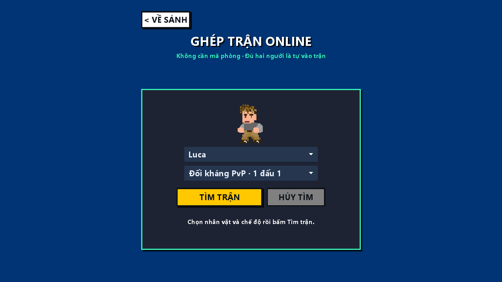
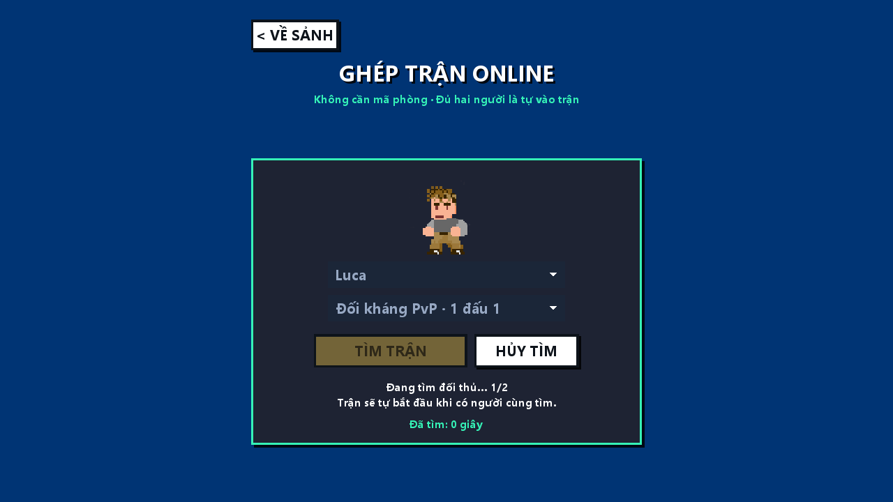

# Ghép trận online

## Cách chơi

Mở website → Online → **Ghép trận nhanh**. Chọn nhân vật, chọn **PvP 1 đấu 1** hoặc
**Boss hai người**, rồi bấm **Tìm trận**. Không cần mã phòng và không cần bấm Sẵn sàng.
Người đầu tiên chờ; khi có người thứ hai cùng chế độ, cả hai chuyển qua màn hình
tải và đếm ngược trước khi vào trận. Nếu chưa có người cùng tìm thì tiếp tục chờ,
không tự thêm bot hoặc giả số lượng người online.

**Hủy tìm** đóng kết nối tìm trận và giải phóng chỗ phía server. Có thể chọn lại
nhân vật/chế độ rồi tìm tiếp. Esc hoặc Về sảnh cũng hủy tìm. Nếu một người thoát
trong lúc tải/countdown, người còn lại chờ người thay thế. Khi trận đã chạy,
disconnect dùng lifecycle hiện có của trận; không thêm người mới vào giữa trận.

Phòng riêng bằng mã giữ luồng chọn nhân vật, sẵn sàng và chỉnh luật 2–4 người.
Phòng ghép nhanh dùng luật cố định hai người: PvP 120 giây, Boss 180 giây,
ba mạng, vật phẩm theo preset của chế độ. Vẫn có kết quả trận và bỏ phiếu tái đấu.
Phiên bản này ghép theo chế độ/chỗ chờ; chưa lọc Elo, ping hoặc khu vực. Chơi cùng
server công khai là điều kiện để tìm thấy nhau. Không có dịch vụ ghép xuyên nhiều VM.

## Tích hợp

`FIND_MATCH` là request v1 có requestId bắt buộc:

```json
{"version":1,"type":"FIND_MATCH","requestId":"find-1","payload":{"mode":"PVP","characterId":"Luca"}}
```

Mode chỉ nhận `PVP`/`BOSS`, character dùng danh mục hiện có. Server lấy danh tính
từ CONNECT; không nhận playerId/roomId do client tự chỉ định. Cần fighter capability,
và Boss cần boss capability. Chế độ cluster dùng assignment hiện tại trả
`MATCHMAKING_UNAVAILABLE`; website Azure đang chạy gateway standalone được hỗ trợ.

`MatchmakingService` tuần tự hóa tìm/chọn chỗ, dùng `JoinRoomHandler` và
`PlayerReadyHandler` hiện có. Chỉ xét phòng đánh dấu matchmaking, đúng chế độ,
còn một chỗ và chưa countdown/playing. Không ghép vào phòng riêng, phòng đầy hoặc
trận đang chơi. Request lặp của cùng session giữ nguyên phòng nếu mode/nhân vật
trùng; đổi yêu cầu khi vẫn ở phòng bị từ chối. Số phòng/kết nối và token bucket
hiện có vẫn giới hạn tài nguyên. Phòng chờ rỗng được dọn khi ngắt kết nối.

Response là `ROOM_STATE` có roster, readiness và rules server đã xác nhận.
Shared `LobbyClient` nhận roomId được cấp rồi dùng roomId đó cho LOAD_READY,
GAME_START, input và rematch. Bỏ qua settings push đi trước response FIND_MATCH;
response mang đủ settings để xác nhận ban đầu. Từ đó nhận broadcast settings
như phòng thường. Hai client báo tải xong mới qua countdown và start chuẩn.

Màn hình `OnlineMatchmakingScreen` dùng chung cho desktop và TeaVM. Tìm/hủy
không chặn render thread. Chỉ bàn giao kết nối cho Game khi roster có đủ hai
người đã ready. Màn hình phòng hỗ trợ chờ ghép lại nếu đối thủ thoát khi tải;
không cho đổi luật hoặc readiness của phòng ghép nhanh.

## Kiểm tra

```powershell
.\scripts\gameplay\Verify.ps1 -Suites @('com.smashprofs.server.network.MatchmakingTcpTest') -ClientSuites @('com.smashprofs.tests.network.MatchmakingClientTest') -Label matchmaking-targeted
.\scripts\web\Run-Web.ps1 -BuildOnly
python .\scripts\web\Verify-Web.py --matchmaking
```

Test TCP/client bao gồm ghép hai chế độ và start thật, request lặp, không tạo
trận cho một người, không ghép lẫn chế độ/phòng riêng, chặn manual JOIN vào chỗ
quick-match, chặn request giả mạo, hủy rồi tìm lại, thay người khi tải và sáu
request đồng thời chỉ tạo ba cặp. Test browser thao tác UI thật, thử hủy/tìm lại,
chọn nhân vật, ghép PvP, cách ly hai chế độ và ghép Boss bằng hai browser context.

Evidence browser ở `runs/20261023-web-matchmaking/`; chỉ `verification.json` với
`status=PASS` xác nhận lần chạy đã qua. Không thay thế kiểm tra ping Internet,
tải nhiều phòng hoặc trải nghiệm chơi bằng tay trên hai máy khác mạng.

Kết quả ngày 23/10/2026: 11 test mới TCP/shared client qua; toàn bộ 830 test hồi
quy qua khi chạy với quyền truy cập IP mạng nội bộ; build TeaVM/protocol test qua;
hai browser context Edge/WebGL qua 9 kiểm tra ghép trận. Lần chạy trong sandbox
trước đó timeout ở bài standalone non-loopback, đã kiểm tra lại riêng và cả bộ.




