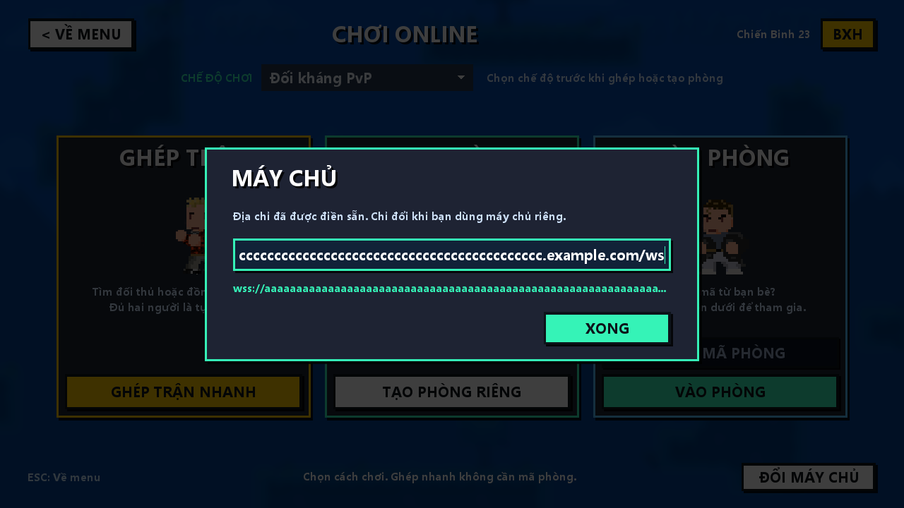

# Sảnh online gọn và không tràn địa chỉ máy chủ

Sảnh có ba lựa chọn riêng: **Ghép trận**, **Tạo phòng**, **Vào phòng**.
Chọn chế độ PvP/Boss ở hàng phía trên. Ghép nhanh là nút vàng bên trái; phòng
riêng ở giữa; ô nhập mã và nút Vào phòng nằm cùng thẻ bên phải. Tên và mô tả
dùng tiếng Việt, không còn thẻ SERVER HOST chiếm một phần ba màn hình.

Địa chỉ máy chủ dài trước đây tham gia tính kích thước tối thiểu của các bảng
Scene2D và làm các hàng trong thẻ server tràn sang thẻ bên cạnh. Bố cục mới giới
hạn chiều rộng các thẻ/ô, cho mô tả và trạng thái xuống dòng, rút gọn tên hồ sơ
dài. Các thẻ thẳng hàng, không xoay phần chứa nút và ô nhập.

**Đổi máy chủ** ở góc dưới mở hộp cấu hình riêng. Web có một ô URL đầy đủ;
desktop giữ IP/host và cổng. Ô nhập dài cuộn ngang trong khung cố định; dòng xem
trước dùng dấu ba chấm. URL ws/wss không bị nối thêm cổng mặc định lần nữa.
Hộp chặn thao tác vào các nút phía sau. Bấm Xong, Enter hoặc Esc để đóng hộp;
Enter trong hộp không gửi yêu cầu Vào phòng. Địa chỉ và luồng kết nối vẫn dùng
cấu hình hiện tại, không thay protocol, matchmaking hoặc luật chơi.

## Kiểm tra

```powershell
.\scripts\web\Run-Web.ps1 -BuildOnly
python .\scripts\web\Verify-Web.py --lobby-layout
python .\scripts\web\Verify-Web.py --matchmaking
```

Verifier dùng Edge/WebGL và gateway cục bộ thật. Thử URL Azure và URL hơn 200 ký
tự; kiểm tra các nút/ô không ra ngoài viewport hoặc chồng nhau ở 1280×720,
960×540 và 1024×768. Thử Enter, chặn click xuyên hộp, tạo phòng và mở màn hình
ghép nhanh. Kiểm tra văn bản tiếng Việt để phát hiện lỗi encoding.

Evidence: `runs/20261023-online-lobby-layout/verification.json` và ảnh bên dưới.
Ngày 23/10/2026: build web/protocol tests qua, native client compile và 3 test
form qua, 8 kiểm tra giao diện và 9 kiểm tra ghép trận bằng hai browser context qua.



