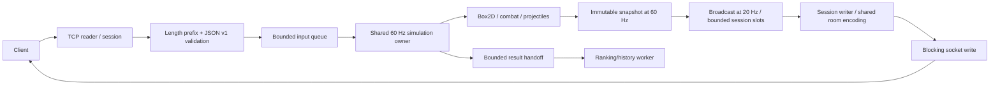

# 01 — Audit source thực tế

**DONE:** audit đường xử lý chính. **PARTIAL:** chưa đo tải đại diện đủ để xếp hạng mọi bottleneck.

| Boundary | Source và phát hiện |
|---|---|
| Accept / session | `TcpServerTransport`: blocking `ServerSocket.accept`, một accept thread; giới hạn connection trước khi cấp reader/writer. Registry `ConnectionManager` dùng concurrent map. |
| I/O | Mỗi connection có một reader và một writer platform thread khi hoạt động. Executor tối đa `maxConnections`, `SynchronousQueue`; không xếp task vô hạn. `TcpSessionChannel` giữ write lock để bảo toàn frame. |
| Framing | `JsonFrameCodec`: 4-byte big-endian length, giới hạn frame/JSON; `MessageInput` giới hạn decode và deadline frame chưa hoàn chỉnh. Idle read và incomplete frame khác nhau. |
| Input | `ProtocolV1Dispatcher` xác thực session/ownership; `InputQueue` dùng `ArrayDeque`, 32 input/player, sequence tăng, drain giữ edge jump/attack. Runtime monitor tranh chấp giữa submit và tick. |
| Simulation | `FixedTickScheduler`: một scheduled owner cho các room, tick tuần tự theo fixed rate. Không có một simulation thread/room. Shared registry lock chỉ bảo vệ metadata; từng registration/runtime có monitor riêng. |
| Native | Mỗi `MatchRuntime` sở hữu một `HeadlessPhysicsWorld`; khởi tạo khi start, dispose khi close. Listeners/bodies/projectiles được bỏ tham chiếu sau World dispose. |
| Snapshot | `GameSnapshotBuilder` tạo immutable state mỗi tick; `StateBroadcaster` gửi mỗi 3 tick ở 20 Hz. Trước thay đổi: mapping/JSON lặp lại cho từng recipient. |
| Broadcast | Trước thay đổi: quét mọi session cho mỗi room. Nhánh index mới nhóm session một lần khi cần publish và có ít nhất 4 room. Guard vẫn kiểm tra room, runtime, session và player trước delivery. |
| Output | Snapshot pending chỉ một slot có thể thay; heartbeat/start riêng; tối đa 4 terminal deliveries. Writer thực hiện mapping/encoding/socket write. Simulation chỉ offer, không ghi TCP hoặc gọi database. |
| Persistence | `MatchResultPublisher`: queue 128, tombstone 4096; lỗi được báo, không giả thành success. `FileMatchHistory` là lưu file prototype, không phải distributed database. |
| HTTP / control | `HttpJson`: 4 threads, queue 128, backlog 64, body <=1 MiB và timeout. Control plane serialize selection/reservation trong một monitor; đây là điểm scale dọc và thiếu HA. |
| Worker | Maintenance 200 ms, heartbeat/metrics khoảng 1 s, lease fencing, drain và cleanup phòng. Metrics allocation dùng cycle p99, CPU, heap, connection/room và outbound pressure. |

Allocation đáng chú ý: Jackson tree/copy và byte arrays, các stream/sort cho roster bất biến, snapshot 60 Hz, queue-drain collections, `getVelocity()` trả vector, copies registry để duyệt an toàn. Các immutable snapshot và bản sao giúp giữ ownership; chưa thay bằng pooling tùy tiện.

Rủi ro còn lại: một room đắt có thể trì hoãn room sau; fixed-rate catch-up chưa có giới hạn; số thread vẫn tuyến tính theo connection; vòng maintain có quét room × session; session/room/ticket chỉ nằm trong memory của một control plane. Không có bằng chứng busy-spin vô hạn trong game loop; scheduler có thể catch-up liên tiếp khi trễ.

Audit phát hiện input pending chưa clear khi abort một trận chưa kết thúc. `MatchRuntime.close()` hiện clear queue; regression kiểm tra close lặp an toàn. Cache mới bị chặn 1024 room, prune khi phòng biến mất và clear khi broadcaster đóng.
