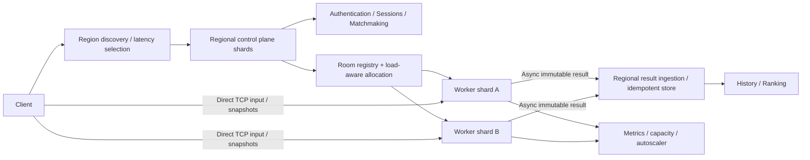

# Kiến trúc đích 100M CCU

Mục tiêu là phân vùng tài nguyên và quyền sở hữu, không tạo một GameServer lớn hơn. Prototype chạy một regional authority trên loopback; multi-region và HA control plane dưới đây là PROPOSED.

**Control plane:** login/session, queue, assignment, worker registry/lease, capacity. Gameplay bytes không đi qua control plane. Authority cần phân shard theo region và control cell; registry production cần atomic reservation/CAS, fencing token, replication và kiểm soát split-brain. Mỗi room là đơn vị placement, không tách vật lý trong cùng trận ra nhiều server.

**Data plane:** worker sở hữu room, input queues, Box2D World và immutable snapshots. Room không migrate giữa trận. Hỏng worker làm match ABORTED cho đến khi có checkpoint/recovery được kiểm chứng. Region failover chỉ tiếp nhận trận mới; không giả định phục hồi trận đang chạy.

**Persistence plane:** ingestion nhận MatchId, chống trùng bằng unique key và transaction; lưu match history và cập nhật ranking idempotent. Cần durable outbox/retry/reconciliation cho crash ngay lúc kết thúc. Adapter file local là bước thử nghiệm, không thay thế DB Member 3.

100M CCU tương ứng 25M phòng 4 người. Chia nhiều region, mỗi region nhiều control cell, mỗi cell nhiều worker độc lập. TCP connection đã thiết lập gắn worker; DNS/global discovery chỉ chọn region, không chuyển stream đang chạy. Chia shard còn giảm blast radius, connection storm và chi phí registry tập trung.

Các giới hạn chưa được giải quyết: HA control/session storage, cross-region account identity, TLS/abuse control, thread/socket scaling ở worker, TCP head-of-line blocking, native memory, result durability qua power loss, managed database/queue, WAN bandwidth và chi phí. Cần benchmark trên nhiều máy và nhiều region trước mọi tuyên bố tải lớn.

Abstraction `WorkerProvisioner` cho phép thay local process manager bằng Kubernetes/Agones. Chính sách drain trước reclaim phù hợp với việc giữ GameServer đang được cấp phát cho trận; tham khảo [Agones scheduling/autoscaling](https://agones.dev/site/docs/advanced/scheduling-and-autoscaling/) và [FleetAutoscaler](https://agones.dev/site/docs/reference/fleetautoscaler/). Chưa tích hợp Agones trong source.
